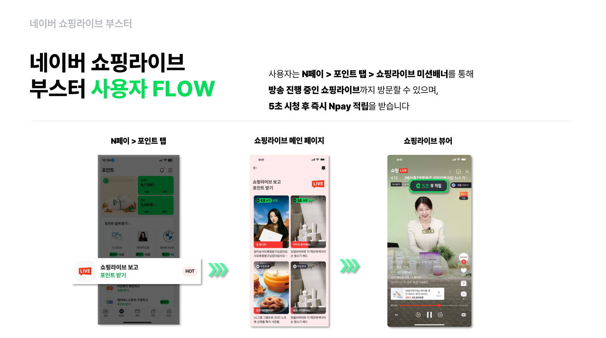

# 네이버 쇼핑라이브 부스터

**"네이버 쇼핑라이브 부스터" 광고란?**

> ‘네이버 쇼핑라이브 부스터’는 ‘네이버 쇼핑라이브’와 ‘네이버페이’가 공동 개발하여 별도의 연동 없이 사용자가 쇼핑라이브 방송을 5초 이상 시청하면 N페이 포인트를 적립해 주는 부스팅 광고로 시청 수를 증대시키고 전환까지 유도하는 광고 상품입니다

<figure><figcaption></figcaption></figure>

| **구분**     | **내용**                                                                                                                                                                                   | **비고**                                                                                        |
| ---------- | ---------------------------------------------------------------------------------------------------------------------------------------------------------------------------------------- | --------------------------------------------------------------------------------------------- |
| **상품명**    | N페이 ‘네이버 쇼핑라이브 부스터                                                                                                                                                                       |                                                                                               |
| **노출 지면**  | N페이(앱&웹) > 포인트 탭 > 쇼핑라이브 미션 배너                                                                                                                                                           |                                                                                               |
| **광고 단가**  | 
1시간 라이브 기준 150만 원(*VAT 별도) *이후 30분 단위(단가 : 50만 원) 증액 가능
                                                                                                                        | \*오픈 기념 프로모션 '26년 6월 30일까지 150만 원 --> 100만 원으로 할인 중                                           |
| **노출 기간**  | 
라이브 당일 0시부터 예고 노출 가능 라이브 타임 상단 노출 라이브 후 다시보기, 라이브 당일 24시까지 노출
                                                                                                               | \*예고 노출은 상품 1개 이상 등록/테스트 방송이 아니어야 노출                                                          |
| **준비 소재**  | 라이브 등록 후 라이브ID, 채널ID 전달 만으로 준비 끝!                                                                                                                                                        | 
*유의할 점 : 쇼핑라이브 어드민에서 네이버페이 광고 동의 필수! *네이버 담당자가 셋팅하는 기획 라이브일 경우, 네이버 담당자가 체크 필요! 
 |
| **고객 적립금** | 
라이브 예고 브릿지 페이지를 통해 라이브뷰어 시청 시 1초 시청 후 1원 적립, 라이브 타임에 한해 사용자가 5초 이상 라이브 시청 시 N페이 포인트 즉시 적립, 당일 24시까지 다시보기 라이브뷰어 시청 시 1초 시청 후 1원 적립 *고객적립금은 “N페이”가 부담하며 적립 금액은 상시 변동될 수 있음
 | 적립 후 푸시 수신 제공                                                                                 |
| **푸시 알림**  | 알림받기 동의 사용자에 한해 라이브 시작 시간에 맞춰 ‘푸시 알림‘ 제공                                                                                                                                                 | \*광고주가 알림 내용을 설정할 수는 없음                                                                       |
| **타겟팅**    | 별도 타겟팅 적용 불가                                                                                                                                                                             |                                                                                               |
| **정산**     | 
광고비는 선불을 기준으로 함 *예고 노출 이후 캠페인 취소 시 환불/정산 불가, D-1일부터 취소 불가 
                                                                                                               | 
*대행수수료 20% 
                                                                         |
| **리포트**    | 예고/라이브/다시보기 각각 노출/유입/CTR – 라이브 종료 후 메일 전달                                                                                                                                                |                                                                                               |
| **광고주**    | 네이버 쇼핑라이브 진행 시 가능                                                                                                                                                                        | 
*네이버 담당자가 셋팅하는 기획 라이브일 경우, 기획라이브임을 고지 필요
                                            |
| **부킹 시점**  | 
라이브 1주 전까지 부킹 권장 *최소 라이브 D-2일까지는 부킹 필요
                                                                                                                                         | \*라이브 D-1일 부터는 취소 불가                                                                          |
| **취소 정책**  | 
D-2일 전: 위약금 없음 D-1일 전: 광고비의 50% 라이브 당일: 광고비의 100%
                                                                                                                           | 
  
                                                                               |

[<mark style="color:red;">쇼핑라이브 구매전환을 올리고 싶다면? 쇼핑라이브 CPS 상품 바로가기></mark>](shoppinglivecps.md)

**\[네이버 쇼핑라이브 부스터 광고문의]**

[dl\_npay\_shoppinglive@navercorp.com](mailto:dl_npay_shoppinglive@navercorp.com)

아래 내용 기재 후 메일로 요청

**\[네이버 쇼핑라이브 부스터 광고문의 양식]**

* 광고주명 :
* 대행사/렙사/스튜디오 :
* 쇼핑라이브 채널ID :
* 쇼핑라이브ID :
* 라이브 일정/시간 :
* 기획라이브 여부 (기획라이브 : 네이버 담당자가 셋팅하는 라이브) : Y/N

#### 📋 네이버페이 쇼핑라이브 부스터 FAQ

**1. 계약 및 정산 안내**

질문: 대행수수료 20%는 누가 부담하며 어디로 입금되나요?

답변: 광고주는 광고비만 부담합니다. 수수료 20%는 네이버페이에서 광고주의 광고 운영 대행사에 지급하게 되며 네이버페이 쇼핑라이브 부스터 운영 공식 대행사인 '핀크럭스'에서 대행사에 지급합니다.

질문: 광고 계약과 입금 절차는 누구와 진행하나요?

답변: 공식 운영사인 '핀크럭스'와 직접 계약을 체결하고 광고비를 입금해 주시면 됩니다.

**2. 방송 세팅 및 채널 정보**

질문: 기획 라이브란 무엇이며, 송출 동의는 어떻게 하나요?

답변: 네이버 담당자가 직접 세팅하는 라이브를 말합니다. 담당자에게 '리얼 라이브' 등록을 요청하신 후, N페이 송출 동의를 진행하시면 됩니다.

질문: 채널 ID는 어디에서 확인할 수 있나요?

답변: 본인 채널홈 URL 주소의 마지막 부분에 위치한 5\~6자리 숫자가 채널 ID입니다.

**3. 광고 비용 및 취소 규정**

질문: 라이브 시간이 1시간을 넘어가면 비용이 추가되나요?

답변: 네, 기본 1시간 초과 시 30분 단위로 50만 원의 광고비가 추가됩니다. (부가세 별도)

질문: 예약된 광고 취소 시 위약금이 발생하나요?

답변: 라이브 2일 전(D-2)까지는 취소가 가능합니다. 다만, 하루 전(D-1)에 취소할 경우 광고비의 50%가 위약금으로 청구됩니다. 라이브 당일에는 취소가 불가능하며, 취소 시 위약금이 100% 부과됩니다.

**4. 성과 지표 및 타겟팅**

질문: 예상 시청수와 성과 확인 기준은 어떻게 되나요?

답변: 1시간 진행 시 평균 15만\~20만 명 이상의 시청수가 발생합니다. 성과는 예고, 라이브, 다시보기를 모두 합산한 '전체 총합'으로 확인합니다.

질문: 특정 사용자에게만 광고를 노출하는 타겟팅이 가능한가요?

답변: 현재 서비스 내에서 별도의 타겟팅 노출 설정은 지원되지 않습니다.

**5. 고객 적립금 혜택**

질문: 고객에게 주는 적립금은 누가 부담하나요?

답변: 적립금 비용은 네이버페이(N페이)에서 전액 부담하므로 광고주 부담은 없습니다.

질문: 단계별 적립금 지급 기준이 궁금합니다.

답변: 예고 페이지 시청 시 1원, 라이브 5초 이상 시청 시 5원, 다시보기 시청 시 1원이 각각 고객에게 적립됩니다.
